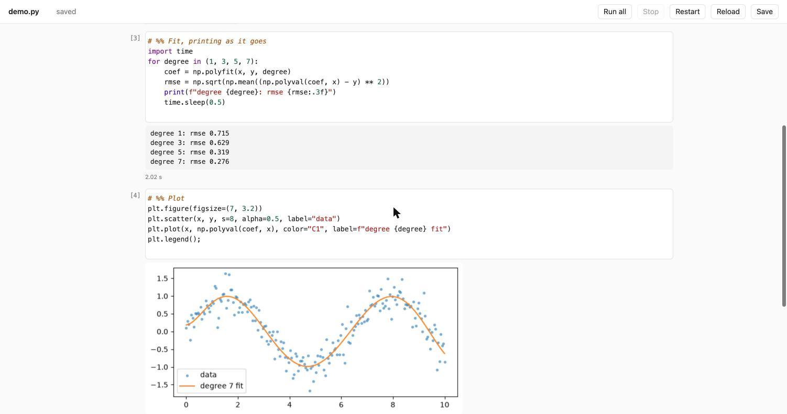

# Python Notebook

A small, plain notebook for Python. It opens an ordinary `.py` file in your browser, splits it
into cells at `# %%` lines, and lets you run them one at a time and see the output underneath,
the way Jupyter does. The file stays a normal Python script that any editor, `python`, or git
can use.



There is no account to log into, no AI assistant, no code completion, no plugin system and no
`.ipynb` file: an editor per cell, a run button, and the output. If your code is increasingly
written by an AI agent of your own choosing, what you need from a notebook is to read it, run
it and look at the results, and that is all this does.

It needs nothing but Python itself: no packages to install, not even Jupyter.

It is the Python sibling of [Julia Notebook](https://github.com/compleathorseplayer/JuliaNotebook).

Why it exists, and who it's for: [Python Notebook: a lightweight notebook for you and your AI agent](https://medium.com/@compleathorseplayer/python-notebook-a-lightweight-notebook-for-you-and-your-ai-agent-6dcf85888156) (Medium).

## What it does

- **Cells from plain text.** Every line starting with `# %%` (or `#%%`) begins a new cell, the
  same convention as VS Code, Spyder, PyCharm and Jupytext, so the file opens as cells there
  too. Text after `# %%` is the cell's title.
- **Live output.** What a cell prints appears as it is printed, so a training loop's progress
  shows up line by line. Progress bars such as `tqdm` update in place.
- **Results inline.** A cell's last value is shown below it: matplotlib plots as images,
  pandas tables as HTML, anything else as text. `display(...)` works too, without importing
  anything. End a cell with `;` to hide its value.
- **Plots without `plt.show()`.** Any figure a cell draws appears below it; `plt.show()` in the
  middle of a cell shows the figure at that point.
- **Stop and Restart.** Stop interrupts a running cell; Restart gives you a fresh Python.
- **Errors point at the file.** Line numbers in tracebacks are the real line numbers in your
  `.py` file.
- **Saves itself.** Edits are saved a second after you stop typing. If the file is changed by
  another program (another editor, or an agent) while you have edits open, it will not
  overwrite that change; it asks you to reload or overwrite.
- **Exit, or just close the window.** Either one saves and stops everything.
- **Works offline.** Nothing is loaded from the internet; the editor
  ([CodeMirror 5](https://codemirror.net/5/)) is included.

## Install

You need Python 3.9 or later. Either install it as a command:

```sh
pipx install git+https://github.com/compleathorseplayer/PythonNotebook.git
```

(`pip install --user git+…` works too), or clone it and put the `pynb` command on your `PATH`:

```sh
git clone https://github.com/compleathorseplayer/PythonNotebook.git
ln -s "$PWD/PythonNotebook/bin/pynb" ~/.local/bin/pynb      # macOS / Linux
```

On Windows, add `PythonNotebook\bin` to your `PATH` (it contains `pynb.cmd`).

## Use

```sh
pynb analysis.py
```

This opens the notebook in your browser. If the file doesn't exist, it is created.

| Key | Action |
|---|---|
| Shift-Enter | Run the cell and move to the next one |
| Cmd/Ctrl-Enter | Run the cell and stay |
| Cmd/Ctrl-. | Stop the running cell |
| Cmd/Ctrl-S | Save now (it also saves by itself) |
| Cmd/Ctrl-/ | Comment or uncomment lines |
| Up / Down at the edge of a cell | Move into the neighbouring cell |

Each cell also has buttons to run it, add a cell below, or delete it. The top bar has
**Run all** (stops at the first error), **Stop**, **Restart**, **Reload**, **Save** and **Exit**.

A file looks like this:

```python
# %% Load
import numpy as np
import matplotlib.pyplot as plt
x = np.linspace(0, 2 * np.pi, 200)

# %% Plot
plt.plot(x, np.sin(x))
```

## Which Python runs your code

Your cells run in a separate Python process, started in the notebook file's folder (so
`import` finds modules next to it). The first of these is used:

1. the one you name: `pynb analysis.py --python ~/envs/ml/bin/python`
2. an activated virtualenv or conda environment
3. a `.venv` or `venv` folder in the notebook's folder or one above it
4. the Python named by the `PYNB_PYTHON` environment variable, if you set one
5. `python3` on your `PATH`

To use one Python for all your notebooks without typing `--python` each time, add a line
like this to your shell startup file (`~/.zshrc` on a Mac):

```sh
export PYNB_PYTHON=~/envs/ml/bin/python
```

The terminal shows which one it picked. Python Notebook itself adds nothing to that
environment: the cells need only the packages your code imports.

## How it works

`pynb` starts a small web server on your computer (reachable only from your own machine, and
protected by a random token in the URL) and opens the page in your browser. The server
starts a second Python process, the worker, which runs your cells. What the worker prints is
passed to the page as it arrives, so output streams; Stop sends the worker an interrupt
(Ctrl-C); Restart replaces it with a new one. Keeping your code out of the server process is
what keeps the page responsive while a long cell runs.

About 1,000 lines in all, standard library only: `pynb/server.py` (server), `pynb/worker.py`
(runs cells), `pynb/assets/index.html` (the page).

## Limitations

- **Stop waits for compiled code.** A pure-Python loop stops at once, but a long call inside a
  compiled library (one big numpy or pandas operation) only notices when that call returns.
  If a cell doesn't respond within 3 seconds, the Stop button becomes **Force stop**, which
  restarts Python.
- **Stop doesn't work on Windows**, which has no way to send the interrupt; use Restart.
- Code that reads from standard input (`input()`) gets an end-of-file error.
- Only images, HTML and text are shown. Interactive widgets (ipywidgets) and plots that need
  JavaScript (Plotly, Bokeh, Altair) won't display; save those to an HTML file instead.
- IPython's `%magic` and `!shell` lines are not Python and won't run.
- One notebook per `pynb` command; run it again (it picks a free port) for another file.
- Developed and tested on macOS (cells on Python 3.10 to 3.13, the server on 3.14). The Linux
  and Windows launchers are included but have not been tested yet.

## Licence

MIT, see [LICENSE](LICENSE). CodeMirror is included under its own MIT licence,
[pynb/assets/LICENSE-CodeMirror](pynb/assets/LICENSE-CodeMirror).
